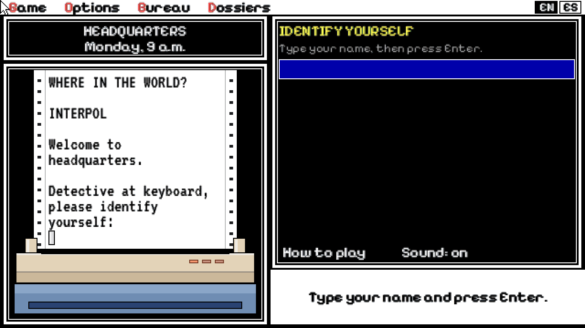
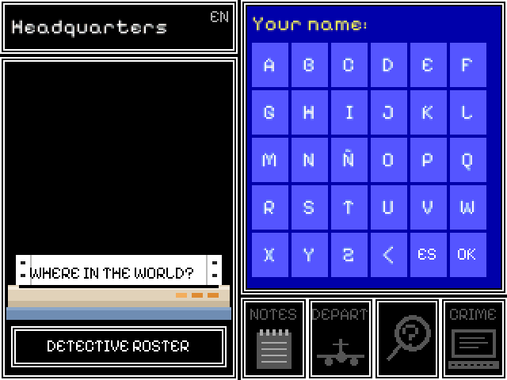
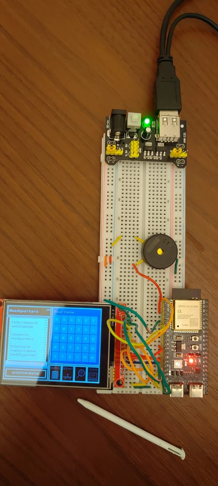
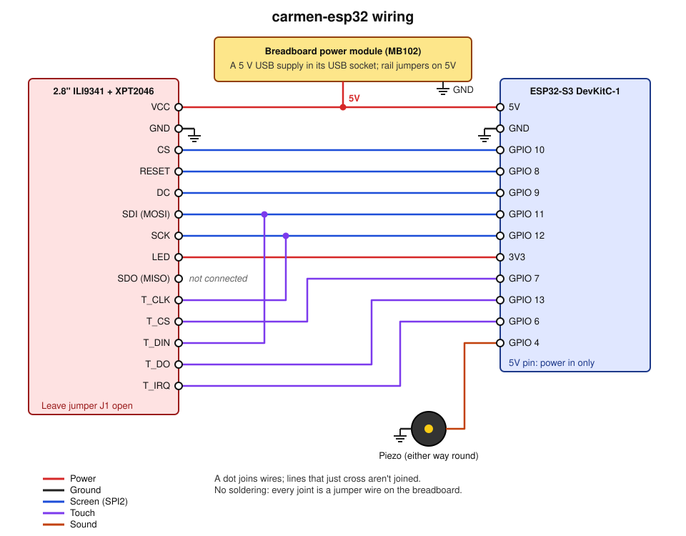

# Where in the World?

[](https://github.com/jonorl/carmen-sandiego/actions/workflows/ci.yml)
[](https://github.com/jonorl/carmen-sandiego/actions/workflows/codeql.yml)
[](https://github.com/jonorl/carmen-sandiego/actions/workflows/deploy-web.yml)
[](https://doc.rust-lang.org/edition-guide/rust-2024/)
[](https://www.espressif.com/en/products/socs/esp32-s3)
[](LICENSE)
[](https://jonathan-orlowski.dev/carmen-sandiego/)

A fan remake of Brøderbund's 1990 *Where in the World is Carmen Sandiego?*, in Rust, with the facts brought up to date. It runs on desktops, in the browser (phones included) and on an ESP32-S3 with a 2.8" touch screen and a piezo, in English or Spanish (Argentina).

Play it at **https://jonathan-orlowski.dev/carmen-sandiego/**.



<p align="center">
  
  
</p>

In the browser, the whole game is a 1.3 MB download: small enough for a 1.44 MB floppy disk, if you still have one.

## What's here

| Folder | What it is |
|---|---|
| [`game/`](game/) | The game for desktops and browsers (macroquad, compiled to WebAssembly for the web), plus `server/`, the records server, and `shared/`, what the two share. |
| [`esp32/`](esp32/) | The standalone ESP32-S3 version, with its own wiring diagram, checks and an emulator that records its demo. |

Both keep each detective's arrests on the same records server, so a rank follows its detective between the board, the browser and the desktop.

## Playing

One of the usual suspects has stolen a treasure. Follow the trail around the world, get a warrant from the crime computer and make the arrest before the deadline.

- **Investigate** (the magnifying glass): each city has three places, each with a witness. On the right trail, witnesses hint at the next country (flags, money, landmarks, food, language) and sometimes describe the thief. In a wrong city nobody has seen a thing, so fly back.
- **Depart** (the plane): four flights leave every city. Pick one from the list or the map.
- **Crime computer**: enter what you've learned. When only one person fits, you get a warrant.
- **Notes** (the notebook): everything witnesses have told you, the deadline and your warrant.

Henchmen of S.U.R.M.E. (the Secret Union of Rapscallions, Mobsters and Evildoers, or in Spanish the Sociedad Unida de Rufianes, Malvivientes y Estafadores) show up when you're on the right track, and the final city gets dangerous. When witnesses say the thief is still in town, you're close: one of the three places is the hideout. With a warrant for the right person you watch the arrest. Without one, they get away.

The clock starts on Monday at 9 a.m. Each interview takes 3 hours, longer flights take longer, and you sleep from 11 p.m. to 7 a.m.

### Ranks

As in the original, you start as a Rookie and are promoted as you make arrests. Each rank's cases are harder.

| Rank | Arrests | Flights to the hideout | Time allowance |
|---|---|---|---|
| Rookie | 0 | 4 | about 2 wrong turns |
| Sleuth | 1 | 4 | about 2 wrong turns, less spare |
| Private Eye | 3 | 5 | about 1 wrong turn |
| Investigator | 6 | 5 | about 1 wrong turn, less spare |
| Ace Detective | 10 | 6 | about 1 wrong turn |
| Super Sleuth | 15 | 6 | almost none |

Your arrests are saved under your name (up to 8 characters, no passwords) on the device and on the records server, so the game carries on offline and catches up later. The detective roster lists everyone.

### The suspects

Twelve of them, from a TV legend with a taste for antiques to a self-proclaimed mighty pirate. Each has a dossier with a photo, their traits and a note; witnesses describe them, and the crime computer narrows them down. They're all in [`game/suspects.json`](game/suspects.json), which you can edit to put your own people in (see [Editing the data](#editing-the-data)).

## Getting it

**Desktop**: ready-built games for Linux, Windows and macOS go on the [releases page](https://github.com/jonorl/carmen-sandiego/releases), one file each. Or, with Rust installed (https://rustup.rs):

```
cd game
cargo run
```

`cargo run -- --seed 42` replays the same case, handy for challenging someone to beat your time.

**Browser**: `cd game && ./build-web.sh` builds it into `game/dist/`, which works on any static web host.

**ESP32-S3**: an ESP32-S3 DevKitC-1 N16R8 with a 2.8" ILI9341 touch screen and a passive piezo, all on a breadboard with no soldering, wired as below. Building and flashing are in [`esp32/README.md`](esp32/README.md).

### Wiring



| Module pin | ESP32-S3 | Note |
|---|---|---|
| VCC | 5V | through the module's regulator; leave J1 open |
| GND | GND | |
| CS | GPIO 10 | |
| RESET | GPIO 8 | |
| DC | GPIO 9 | |
| SDI (MOSI) | GPIO 11 | |
| SCK | GPIO 12 | |
| LED | 3V3 | backlight, always on |
| SDO (MISO) | not connected | never read, and on these modules it can hold the shared line against the touch chip |
| T_CLK | GPIO 12 | shared with SCK |
| T_CS | GPIO 7 | |
| T_DIN | GPIO 11 | shared with SDI |
| T_DO | GPIO 13 | |
| T_IRQ | GPIO 6 | |
| Piezo | GPIO 4 and GND | either way round; GND leg to GPIO 5 to drive it from both sides if too quiet |

GPIO 10-13 are SPI2's own pins, so the screen can run at 40 MHz. Kept clear: 0, 3, 45 and 46 (boot straps), 19 and 20 (USB), 26-37 (flash and PSRAM), 43 and 44 (the console) and the RGB LED (38 or 48).

The board's 5V pin only takes power in, so feed it and the screen from one 5 V supply. A 5.1 V USB supply into the breadboard power module's USB socket works (the photo above); a 12 V adapter through that module's own regulator overheats within a minute.

`esp32/README.md` has checks for the wiring once it's flashed (`--bin pins`, `screen`, `touch`, `sound`).

## Editing the data

The game is driven by two files, checked by `cd game && cargo run -- --check`:

- [`suspects.json`](game/suspects.json): the suspects, their traits and the witnesses' sentences. A dossier photo is a small pixel-art picture made with `game/tools/portrait.sh photo.jpg "Their Name"` (needs ImageMagick).
- [`countries.json`](game/countries.json): 33 countries with about 220 clues (flags, money, languages, landmarks, geography and culture), each in English and Spanish.

[`game/README.md`](game/README.md) explains both in full. The ESP32 version keeps its own copies in `esp32/`: copy them across after editing.

## Working on the code

- [`game/README.md`](game/README.md): building, the server, the tests and how the code is laid out.
- [`esp32/README.md`](esp32/README.md): wiring, building, the hardware checks and the emulator.

Each folder's `CLAUDE.md` describes every file and how the pieces fit together.

## Credits

- The original game: *Where in the World is Carmen Sandiego?* © 1990 Brøderbund Software. This is a fan remake, made for fun. The animations, jail and sounds were traced and cut from recordings of the original.
- Dossier photos: see [`game/assets/suspects/CREDITS.md`](game/assets/suspects/CREDITS.md).
- Map: Natural Earth (public domain).
- Fonts: Pixelify Sans, VT323 and Noto Sans, under the SIL Open Font License.

## Licence

The code is under the MIT licence ([`LICENSE`](LICENSE)). That doesn't cover the original game's art and sounds traced into `assets/sprites/` and `assets/sounds/`, the dossier photos in `assets/suspects/` (each keeps the licence in its `CREDITS.md`), or the fonts, which keep their own licences.
