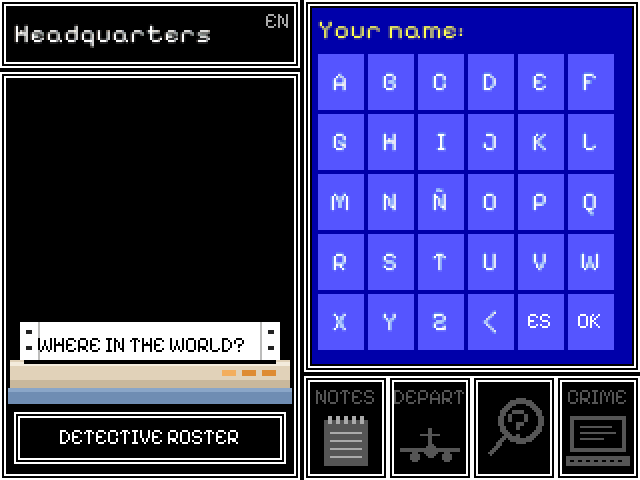
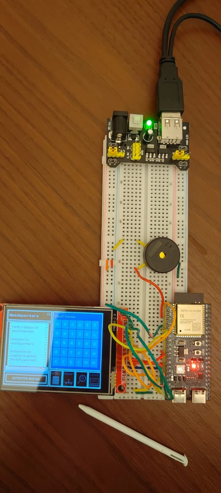
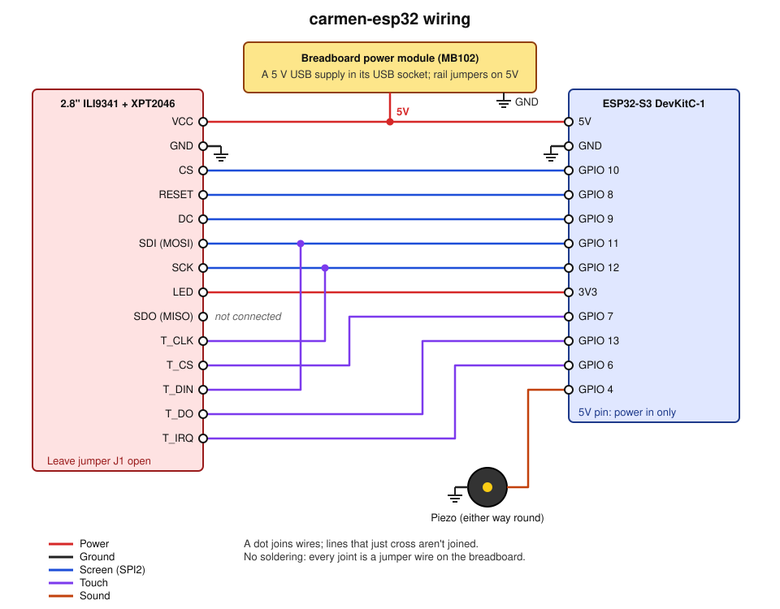

# carmen-esp32

[](https://github.com/jonorl/carmen-sandiego/actions/workflows/ci.yml)
[](https://github.com/jonorl/carmen-sandiego/actions/workflows/codeql.yml)
[](https://doc.rust-lang.org/edition-guide/rust-2024/)
[](https://www.espressif.com/en/products/socs/esp32-s3)
[](LICENSE)

Where in the World? on an ESP32-S3: a standalone, touch-screen version of
[the game](../game) ("Carmen" below), a remake of
*Where in the World is Carmen Sandiego?*. It copies what it needs from the
game rather than sharing code with it.

<p align="center">
  
  
</p>

It's built for an ESP32-S3 DevKitC-1 N16R8 (16 MB flash, 8 MB octal PSRAM)
with a 2.8" 320x240 ILI9341 SPI screen with an XPT2046 resistive touch panel,
and a passive piezo (Murata PKM22EPPH4001-B, loudest near 4 kHz).

It plays the game, laid out as the original (clock and picture on the left,
text panel and four buttons on the right): type your name on the on-screen
keyboard, read the briefing, then investigate, fly, keep notes and fill in
the crime computer until the arrest, a page of text at a time (tap the panel
for the next). The original's animations play in the text panel (henchmen,
the final city's warnings, the chase, the walk to jail and the jail; a tap
skips one), with its tunes on the piezo. Tap the clock to switch between
English and Spanish. Arrests are kept in flash per name, and promote you as
in the game; over WiFi they're also kept on the bureau's server, as the
desktop and web games keep them, so a rank follows its detective everywhere.
The detective roster (from headquarters, or the crime computer's last row)
lists everyone on the server, or this device's records without it; the files
(the crime computer's last row) show each suspect's photo and dossier.

The picture frame follows what you're doing, as the original's did: the
three places stacked while you choose one (tap a picture or its row), the
map while departing (tap a city or its row), with the plane crossing it in
flight, and the crime computer with its printer, where verdicts print a line
at a time (tap to finish). A promotion prints at the end of a case. A
witness stands in the bottom left corner of the text panel while they talk.
At headquarters the printer signs you in, echoing your name as you type it,
and gives your rank before the briefing. The clock catches up an hour at a
time, ticking, faster through nights and flights, and turns red when the
deadline is 12 hours away or less. Still to come: give up, how to play,
About, and a switch for the sound.

## Wiring



| Module pin | ESP32-S3 | Note |
|---|---|---|
| VCC | 5V | through the module's regulator; leave J1 open |
| GND | GND | |
| CS | GPIO 10 | |
| RESET | GPIO 8 | |
| DC | GPIO 9 | |
| SDI (MOSI) | GPIO 11 | |
| SCK | GPIO 12 | |
| LED | 3V3 | backlight, always on |
| SDO (MISO) | not connected | never read, and on these modules it can hold the shared line against the touch chip |
| T_CLK | GPIO 12 | shared with SCK |
| T_CS | GPIO 7 | |
| T_DIN | GPIO 11 | shared with SDI |
| T_DO | GPIO 13 | |
| T_IRQ | GPIO 6 | |
| Piezo | GPIO 4 and GND | either way round; GND leg to GPIO 5 to drive it from both sides if too quiet |

GPIO 10-13 are SPI2's own pins, so the screen can run at 40 MHz. Kept clear:
0, 3, 45 and 46 (boot straps), 19 and 20 (USB), 26-37 (flash and PSRAM), 43
and 44 (the console) and the RGB LED (38 or 48).

## WiFi

`cfg.toml` (kept out of git; copy `cfg.toml.example`) names the network and
the bureau's server, and is built into the firmware, as in the pollution
firmware: rebuild after changing it. The game starts without waiting for the
network; with none, arrests stay on the device and the roster shows its own.

## Building

Needs the `esp` toolchain (`espup install`), `ldproxy` and `espflash`. The
first build downloads ESP-IDF. Plug the board in by its USB port, then in this
folder:

```
cargo run --release
```

builds, flashes (with `partitions.csv`, an 8 MB app partition) and opens the
serial monitor.

Without the toolchain, flash a release instead: each one on the
[releases page](https://github.com/jonorl/carmen-sandiego/releases) (the `esp32-v` ones) has
`carmen-esp32.bin`, the bootloader, partition table and game in one image.
With [espflash](https://github.com/esp-rs/espflash) installed:

```
espflash write-bin 0x0 carmen-esp32.bin
```

Releases are built without `cfg.toml`, so they play offline: for the bureau's
server, build your own with your WiFi settings. Push a tag matching
`Cargo.toml`'s version (`esp32-v0.1.0`) to make one (`.github/workflows/release-esp32.yml`
at the repository's top level).

The board's 5V pin only takes power in, so feed it and the screen from one
5 V supply. A 5.1 V USB supply into the breadboard power module's USB socket
works (the photo); a 12 V adapter through that module's own regulator
overheats within a minute, and some wall sockets' USB ports cut out when the
board starts.

## Testing

The device has no test harness, so the game's code is checked on the
computer, through the emulator (`tools/emulator`, which builds the same
modules):

```
rustfmt +stable --edition 2024 --check $(git ls-files '*.rs')
cd tools/emulator
cargo clippy --release --all-targets -- -D warnings
cargo test --release
```

The tests are the rules' own, copied from Carmen: the data files are valid,
the same seed replays the same case, and a careful player on the right trail
always wins, among others. CI runs these on every push and pull request, and
lints and builds the firmware with the `esp` toolchain; CodeQL scans the code weekly
and Dependabot proposes updates. The hardware itself can only be tested on the
board: the checks under "Checking the wiring" below are for that.

## The demo

`docs/demo.gif` is recorded on the computer by `tools/emulator`: the game's
own code, with the screen, piezo, flash and WiFi stood in for, playing a
scripted case in real time (about two minutes). It needs ffmpeg:

```
cd tools/emulator && cargo run --release
```

## Copied from Carmen

Copied from the game in `../game`, then freed of macroquad:

- `src/art/pixels.rs`, `scene.rs`, `landmarks.rs`: the postcards
  (`scene::paint` gives a `Canvas`).
- `src/art/places.rs` and `people.rs`: the places' pictures and the
  witnesses' portraits (and drawn ones for suspects without a photo). Changed
  here: they paint one `Canvas` when asked (`places::picture`,
  `people::witness`, `people::suspect_portrait`) instead of every texture at
  start, and `photo_name` and its test went, since `sprites.rs` has its own.
- `assets/ne_110m_land.geojson`: the map's coastlines (Natural Earth, public
  domain), packed into points by `build.rs`. `src/art/map.rs` is the game's
  `MapView` drawing into a `Canvas`.
- `src/rules/game.rs`, `data.rs`, `rng.rs`: the rules and data loading.
  Changed here: `Game::route` is public, for the self-playing check; one
  `rng.choice` call names its type (`::<&str>`), which the `esp` toolchain's
  newer Rust can't infer; and the Spanish clock is short for the small
  screen ("martes, 3 pm" for "martes, 3 de la tarde", and "hasta las 7 am"
  in the night at a hotel).
- `src/lang.rs`: English and Spanish. Unchanged: the device has no system
  language, so it starts in English until one is chosen; the choice is saved
  through `src/device/storage.rs` (flash) instead of the game's files.
- `countries.json`, `suspects.json`
- `assets/suspects/`: the suspects' dossier photos (66x96), made by Carmen's
  `tools/portrait.sh` (sources in `assets/suspects/CREDITS.md`).
- `assets/sprites/`: the original's animation frames, traced by Carmen from
  recordings of it.
- The tunes: `src/device/tunes.rs` is written from Carmen's recordings
  (`assets/sounds/`, not copied) by `tools/transcribe.py`, which follows each
  tune's melody (the strongest pitch above the bass) and raises it by
  octaves into the piezo's loud range:
  `python3 tools/transcribe.py ../game/assets/sounds` (needs ffmpeg and
  numpy).
- `assets/fonts/`: Pixelify Sans, VT323 and Noto Sans (₹ only), already cut
  down to the characters the game shows, with their SIL OFL licences.

Changes to these in the game don't arrive here by themselves: carry them over
by hand in the same change, and note here anything changed in the copy. Their `#[cfg(test)]` tests run on the
computer through the emulator (see Testing), which links `countries.json` and
`suspects.json` into its folder so they find them.

## Checking the wiring

```
cargo run --release --bin pins
```

flashes a wiring check instead (`src/bin/pins.rs`) and prints its findings:
pins stuck to GND or a supply, pins joined to each other, whether touching
the screen reaches T_IRQ, and whether the display chip answers (join the
display's SDO to GPIO 13 for that part). Then each pin blinks in turn (once a
second for 6 s), for a meter or an LED on the display's pins.

`cargo run --release --bin screen` (`src/bin/screen.rs`) shows the `mipidsi`
crate's test image, then the whole screen red, green, blue and white. A first
driver of our own drew corrupted pictures where this one drew right, so
`src/display.rs` now draws through `mipidsi` too.

`cargo run --release --bin case` (`src/bin/case.rs`) runs the game's rules
with nothing drawn: it loads and checks the data, then plays a case in English
and one in Spanish as a careful player would, printing everything the game
says with timings and free memory. It also counts its starts in flash.

`cargo run --release --bin text` (`src/bin/text.rs`) shows the fonts with
the game's own text in both languages: body text in Pixelify Sans at 13 px,
smoothed (chosen on the screen over 11 and 14 px), across the screen and in
a half-screen panel; labels at 11 px and headings at 22 px, both the font's
own pixels; and VT323 at 25 px for the printer.

`cargo run --release --bin postcards` (`src/bin/postcards.rs`) shows every
country's postcard at the picture frame's size two ways: shrunk to fit, as
the game shows it, and the full-size scene through a window.

`cargo run --release --bin sound` (`src/bin/sound.rs`) plays a scale from
C5 to C8, then every effect and tune, naming each in the log.

`cargo run --release --bin layout` (`src/bin/layout.rs`) mocks two ways to
lay the game out on 320x240 with real content (Lima's postcard, the clock, a
witness, the four buttons): A as the original, picture left and text right,
and B stacked. Tap the screen to go from one to the next, in English then
Spanish.

`cargo run --release --bin touch` (`src/bin/touch.rs`) tests the touch panel
(`src/touch.rs`): tap the three crosshairs to calibrate it, then draw with a
finger; the red box at the top right clears the screen.
